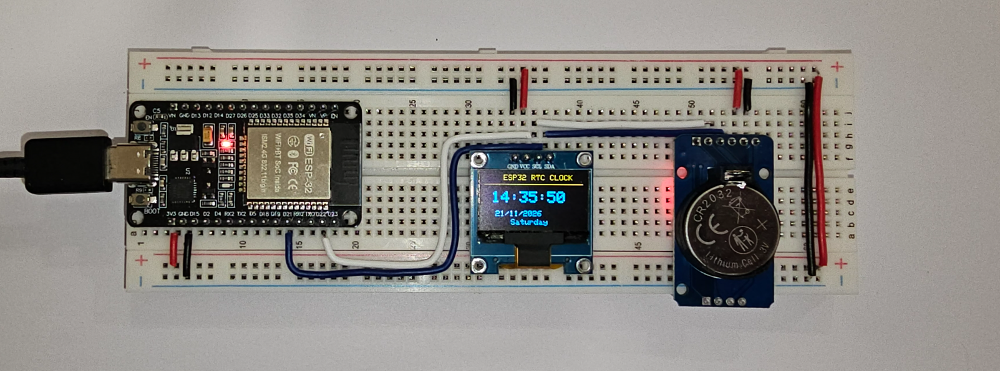

# ESP32 RTC Digital Clock – DS3231 + OLED SSD1306

A simple digital clock project built using an **ESP32**, **DS3231 Real-Time Clock (RTC)** module, and a **128×64 OLED SSD1306 display**.

The project displays the current time, date, and day of the week on the OLED screen. The DS3231 maintains time independently using its internal clock and backup battery, even when the ESP32 is powered off.



## Features

- Real-time clock using DS3231.
- 128×64 OLED display using SSD1306.
- Displays hours, minutes, and seconds.
- Displays date (DD/MM/YYYY).
- Displays day of the week.
- Serial Monitor output for debugging.
- Automatic RTC initialization if power is lost.
- Uses ESP32 I2C interface.

## Hardware Requirements

| Component | Description |
|---|---|
| ESP32 | Development board |
| DS3231 | Real-Time Clock module |
| OLED SSD1306 | 128×64, I2C, 0x3C |
| Jumper wires | Connecting components |
| Battery | DS3231 backup battery |

## Hardware Connections

Both the OLED and DS3231 communicate through the same I2C bus.

| ESP32 | OLED SSD1306 | DS3231 |
|---|---|---|
| GPIO 21 | SDA | SDA |
| GPIO 22 | SCL | SCL |
| 3.3V | VCC | VCC* |
| GND | GND | GND |

*Check the DS3231 module's voltage requirements before connecting it.*

## Required Arduino Libraries

Install the following libraries using Arduino IDE Library Manager:

1. **Adafruit SSD1306**
2. **Adafruit GFX Library**
3. **RTClib** by Adafruit

## Software Configuration

### OLED Configuration

```cpp
#define SCREEN_WIDTH 128
#define SCREEN_HEIGHT 64
#define OLED_RESET -1
#define OLED_ADDRESS 0x3C
```

### I2C Configuration

```cpp
#define SDA_PIN 21
#define SCL_PIN 22
```

### RTC Initialization

```cpp
RTC_DS3231 rtc;
```

## Time Initialization

The DS3231 has its own internal clock and does not require the ESP32 to remain powered to maintain time.

The project checks whether the RTC has lost power:

```cpp
if (rtc.lostPower()) {
    rtc.adjust(DateTime(F(__DATE__), F(__TIME__)));
}
```

The time is initialized using the Arduino compiler's date and time:

- `__DATE__`: Date when the sketch was compiled.
- `__TIME__`: Time when the sketch was compiled.

**Important:** The initial time comes from the computer running Arduino IDE. Make sure its system clock and timezone are correct before compiling.

After initialization, the DS3231 maintains time using its internal oscillator and backup battery.

## Resetting the RTC

To manually reset the RTC to the Arduino compilation time, temporarily use:

```cpp
rtc.adjust(DateTime(F(__DATE__), F(__TIME__)));
```

Upload the sketch once. Then restore the original `rtc.lostPower()` condition to prevent resetting the clock on every restart.

## Timezone Configuration

The current implementation reads the time directly from the DS3231 without applying a timezone offset.

For Jordan local time, use the `Asia/Amman` timezone (UTC+3 under the current timezone rules).

If you later add NTP synchronization, you can synchronize the RTC from an internet time server and then maintain time independently using the DS3231.

## OLED Display Layout

The display presents three main sections:

| Section | Information |
|---|---|
| Header | ESP32 RTC CLOCK |
| Main | HH:MM:SS |
| Date | DD/MM/YYYY |
| Footer | Day of the week |

## Troubleshooting

| Problem | Possible Solution |
|---|---|
| OLED initialization failed | Check I2C address and wiring |
| RTC not found | Check SDA, SCL, VCC and GND |
| Incorrect time | Verify PC system time before compiling |
| RTC resets after power loss | Check the backup battery |
| OLED remains blank | Verify the display controller is SSD1306 |

## Project Architecture

```text
              ESP32
                |
          I2C Interface
           GPIO 21/22
                |
         +------+------+
         |             |
      SSD1306        DS3231
       OLED           RTC
         |             |
    Time Display   Timekeeping
                       |
                  Backup Battery
```

---

**Built with ESP32 | DS3231 | Adafruit SSD1306 | Arduino IDE**
